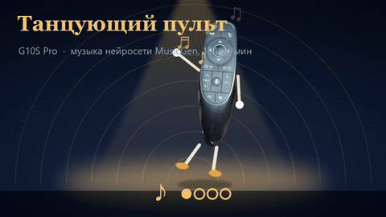
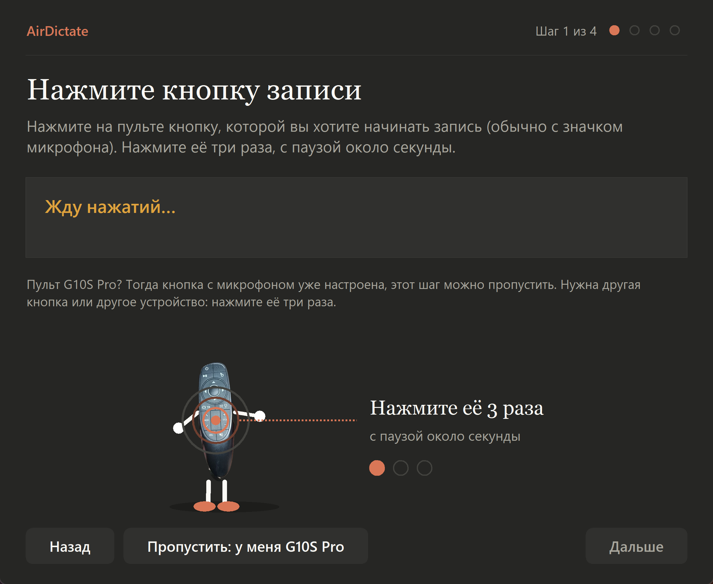

# AirDictate

**Диктовка в приложение Claude с воздушного пульта.** Нажали кнопку микрофона на пульте, сказали фразу, замолчали, и сообщение ушло в чат. Клавиатура и мышь не нужны.

<p align="center">
  
  <br><em>Танцующий пульт. Он танцует в такт под музыку, а вам в это время никто не мешает диктовать.</em>
</p>



## Что умеет

- **Диктовка в Claude с пульта.** Кнопка микрофона запускает запись. Пауза в речи или повторное нажатие отправляют сообщение. Клик мышью ставит запись на паузу, текст остаётся в поле.
- **Круговой набиратель.** Цифры, знаки и пробел с пульта в любом поле ввода. Несколько тем оформления.
- **Кнопка подсветки как правая кнопка мыши.**
- **Мастер настройки.** Запоминает кнопку записи и микрофон пульта. Поддерживает любой пульт с кнопкой микрофона.
- **Работа в фоне.** Значок в трее, автозапуск с Windows. Задача в Планировщике поднимает программу, если она выключилась.

## Установка

Нужен Windows 10 или 11. Python не нужен.

Скачайте файлы из [последнего релиза](../../releases/latest):

- **`AirDictate-1.0-Setup.zip`** — установщик. Внутри `AirDictate-1.0-Setup.exe`. Ставит программу в папку пользователя, без прав администратора, создаёт ярлык в меню «Пуск» и удаляется через «Параметры → Приложения».
- **`AirDictate-1.0-windows.zip`** — портативная версия. Распакуйте и запустите `AirDictate.exe`, ничего не устанавливается.

Windows при первом запуске может предупредить о неизвестном издателе: программа пока не подписана сертификатом. Нажмите «Подробнее» → «Выполнить в любом случае».

Затем в мастере нажмите кнопку записи на пульте три раза (или «Пропустить», если у вас G10S Pro), отметьте микрофон пульта и сохраните.

Подробная инструкция: [docs/MANUAL.md](docs/MANUAL.md). Список изменений: [CHANGELOG.md](CHANGELOG.md).

## Управление пультом

| Что нажать | Что произойдёт |
|---|---|
| **Микрофон** | начинается запись |
| **Микрофон** во время записи | запись останавливается, фраза отправляется в Claude |
| **Пауза в речи** (2,2 секунды) | то же, что и кнопка: фраза отправляется |
| **OK** (клик) во время записи | пауза, текст остаётся в поле, ничего не отправляется |
| **Вправо** в поле ввода | открывается круговой набиратель |

## Требования и ограничения

Программа не работает «сразу после установки». Перед первым использованием нужна настройка, и она зависит от вашего пульта и компьютера.

- **Windows 10 или 11.** Других систем нет.
- **Приложение Claude для рабочего стола** со стандартным интерфейсом. Программа находит кнопку диктовки по её названию. Если интерфейс или язык другие, кнопка может не найтись (см. `mic_button_pattern` в [документации](docs/MANUAL.md)).
- **Пульт с кнопкой микрофона** и USB-приёмником 2,4 ГГц. Проверено на G10S Pro. Другие пульты могут работать, но не все проверены.
- **Мастер настройки.** При первом запуске он учит программу кнопке записи и микрофону пульта. Без него правильно работает только стандартная кнопка G10S Pro.
- **Запасной вариант.** Если диктовка не нажимается, проверьте, что окно Claude открыто на экране с полем ввода, и запустите `AirDictate.exe --check`. Результат записывается в журнал `voice_remote.log`.

## Сборка из исходников

```powershell
powershell -ExecutionPolicy Bypass -File build.ps1
```

Скрипт соберёт `dist\AirDictate\AirDictate.exe` и скопирует туда README. Зависимости: `requirements.txt`.

## Статус

Версия 1.0. Диктовка с пульта G10S Pro проверена на Windows 11 с Claude для рабочего стола. Другие пульты и другие версии Claude проверены не все.

## Лицензия

[MIT](LICENSE). Программу можно использовать, менять и распространять, в том числе в коммерческих целях, при условии что сохраняется уведомление об авторстве. Гарантий нет.

> AirDictate не связан с Anthropic. Claude и Google Chrome — названия сторонних программ.
